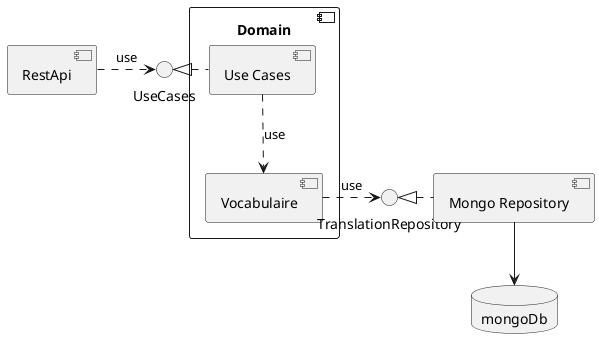
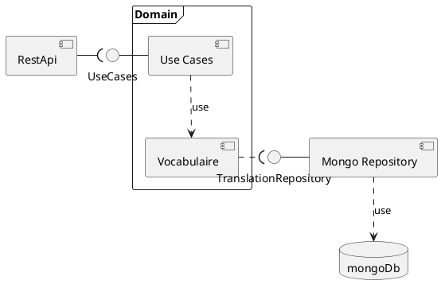
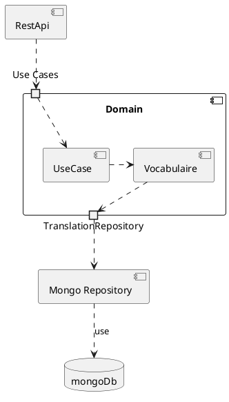

# Vocabulaire

## About

Improve vocabulary of a foreign language by practicing to and from translations. When learning french, I listed all the interesting words in a book. While practising, I try to memorize the words in the order they are listed in the book. After some time, I realized that I start to make associations between words just because they are next to each other. So this process needs randomization and thus software.

So this project aims at:
- Showcase of Rust project with all the bells ans whistles
- Create a tool to learn a foreign language

## How To

Start the docker container with the DB
`docker compose -f docker-compose.yml up -d --build --remove-orphans`

Build and start the application: `cargo run`

Stop:
`docker compose -f docker/docker-compose.yml down`
or
`docker container stop mongo_container && docker rm mongo_container`

## System Overview

The top level architecture is intended to be clean as in onion shaped. The concrete implementation is "ports and adapters"

### Domain

The "domain" defines domain entities and use cases. The use cases are not actually behind and interface but provide just API-functions. These are the "driving" ports
The domain defines a port for the `TranslationRepository` to persist data. This is the "driven" port.

### External Components

The Rest API uses the driving port.

The Mongo Repository adapter implements the `TranslationRepository` port.

This Variant of the component diagram shows how the components are connected. Note that "Domain" is just a frame around some components

This diagram only shows top level components and their ports. This is the closest approximation to a full composite structure diagram

